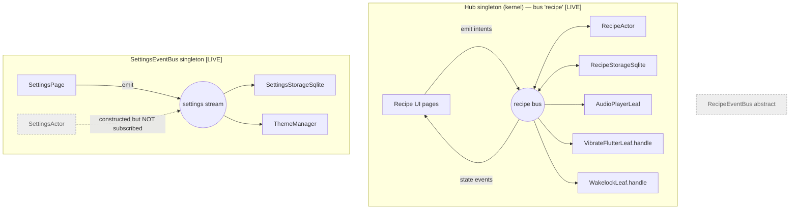

# Architecture

The app is built on a **custom event-bus / actor pattern**, not on a
conventional MVC/BLoC/Riverpod stack. UI widgets are thin: they *emit* intent
events onto a bus and *listen* to state events coming back. All logic lives in
**leaf/actor** objects registered on the bus.

## The building blocks

### `Event` — the message base type
`lib/core/events/event.dart`

```dart
abstract class Event { const Event(); }
```

Every message is an `Event` subclass. Domain events add their own base
(`RecipeEvent`, `SettingsEvent`) but they all ultimately extend `Event`, so a
single broadcast stream can carry any of them. Handlers switch on the concrete
type (Dart pattern-matching `switch`).

### `Leaf` — an actor
`lib/core/di/hub.dart`

```dart
abstract class Leaf {
  void emit(Event event);              // pushes back onto the leaf's bus
  Future<void> handleEvent(Event e);   // abstract — the leaf's logic
  void initialize() {}
  void dispose() {}
}
```

A `Leaf` receives events via `handleEvent` and can `emit` new events back onto
the same bus it was registered on. `RecipeActor`, `RecipeStorageSqlite`, and
`AudioPlayerLeaf` are true `Leaf`s. `VibrateFlutterLeaf` and `WakelockLeaf` are
*not* — they are lightweight classes exposing a `static handle(Event)` function
subscribed directly to the bus.

### `Hub` — the bus registry (the runtime that's actually used)
`lib/core/di/hub.dart`, exposed as `final kernel = Hub()` in `lib/core/di.dart`.

`Hub` is a **singleton** that manages:
- **Named buses** — a `Map<String, StreamController<Event>.broadcast>`. The app
  uses one bus named `'recipe'`.
- **Leaves** — a `Map<String, Leaf>` registry.
- **Subscriptions** — a `Map<String, StreamSubscription>` keyed by module name.

Key API:

| Method | Purpose |
|--------|---------|
| `registerBus(name)` | create a broadcast stream controller for a bus |
| `registerLeaf({busName, name, leaf})` | store the leaf, wire its `emit` to the bus controller, subscribe its `handleEvent`, call `initialize()` |
| `subscribe({busName, moduleName, handler})` | subscribe an arbitrary handler to a bus |
| `emit(busName, event)` | fire an event onto a bus (all subscribers see it) |
| `emitToLeaf(leafName, event)` | call one leaf's `handleEvent` directly, bypassing the bus |
| `getStream(busName)` | the broadcast stream for a bus (UI listens here) |
| `disposeModule` / `disposeBus` / `disposeAll` | teardown |

Because the controllers are **broadcast**, every subscriber on a bus sees every
event; each handler filters by type. There is no request/response addressing —
correlation is by convention (an actor emits a `*Loaded` event in response to a
`*Load` event, and interested listeners pick it up).

## The buses

There are **three** bus-like things in the codebase; only two are live.



1. **`Hub` / `kernel`** — the recipe domain. Everything recipe-related and all
   the hardware effects (audio, vibrate, wakelock) ride the single `'recipe'`
   bus. This is what `main.dart` wires up. UI reaches it through a
   `BuildContext` extension:

   ```dart
   // lib/core/recipe/ui/extensions/recipe_bus_extension.dart
   extension RecipeEventBusX on BuildContext {
     Stream<Event> get recipeStream => kernel.getStream('recipe');
   }
   ```
   Pages emit with `kernel.emit('recipe', event)` and subscribe with
   `context.recipeStream.listen(...)`.

2. **`SettingsEventBus`** — `lib/core/settings/buses/settings_event_bus.dart`.
   A *separate* singleton (`SettingsEventBus.instance`) wrapping one broadcast
   `StreamController`. It has no named buses, no leaf registry, and no
   auto-subscription — consumers call `.fire(event)` and `.stream.listen(...)`
   manually. Settings deliberately does **not** use the `Hub`.

3. **`RecipeEventBus`** — `lib/core/recipe/buses/recipe_event_bus.dart`. An
   abstract class + `_RecipeEventBusImpl` singleton with the same
   `fire`/`stream`/`dispose` shape as `SettingsEventBus`. It exists and is
   referenced by the (thin) `recipe_bus_extension`, but the recipe UI actually
   goes through `kernel.getStream('recipe')`, so this bus is essentially vestigial.

## Bootstrap — `main.dart`

`main()` wires the whole system before `runApp`:

```dart
// 1. Open the SQLite DB
final db = SqliteDatabase(path: <appDocs>/recipes.db);

// 2. Recipe domain on the Hub
Hub()
  ..registerBus('recipe')
  ..registerLeaf(busName: 'recipe', name: 'audioPlayer',   leaf: AudioPlayerLeaf())
  ..registerLeaf(busName: 'recipe', name: 'recipeActor',   leaf: RecipeActor())
  ..registerLeaf(busName: 'recipe', name: 'recipeStorage', leaf: RecipeStorageSqlite(db: db))
  ..subscribe(busName: 'recipe', moduleName: 'observer',        handler: print-logger)
  ..subscribe(busName: 'recipe', moduleName: 'recipeToVibrate', handler: VibrateFlutterLeaf.handle)
  ..subscribe(busName: 'recipe', moduleName: 'recipeToWakeLock',handler: WakelockLeaf.handle)
  ..emitToLeaf('audioPlayer', const AudioInitialize());

// 3. Settings domain on its own bus
final settingsBus = SettingsEventBus.instance..init();
SettingsActor(emit: settingsBus.fire);                 // ⚠ constructed, never subscribed
final settingsStorage = SettingsStorageSqlite(db: db, emit: settingsBus.fire);
await settingsStorage.initialize();
settingsBus.stream.listen(settingsStorage.handleEvent);
settingsBus.stream.listen(ThemeManager.instance.handleEvent);
settingsBus.fire(const SettingsLoad());

// 4. App with reactive theming
runApp(const MyApp());   // MaterialApp inside ListenableBuilder(ThemeManager.instance)
```

`MyApp` wraps `MaterialApp` in a `ListenableBuilder` bound to
`ThemeManager.instance`, so theme/accent changes rebuild the app. Home is
`RecipeListPage`.

> ⚠ **`SettingsActor` is dead in the running app.** It is created but its
> `handleEvent` is never `listen`-ed to the settings bus. See
> [modules.md → Settings](modules.md#settings-core).

## The canonical event flow (command → storage → state)

The recipe domain follows a consistent request/response loop. Example — loading
recipes:

```mermaid
sequenceDiagram
  participant UI as RecipeListPage
  participant Bus as recipe bus (Hub)
  participant Actor as RecipeActor
  participant Store as RecipeStorageSqlite
  UI->>Bus: RecipesLoad
  Bus->>Actor: RecipesLoad
  alt cache empty
    Actor->>Bus: RecipesLoadStorage
    Bus->>Store: RecipesLoadStorage
    Store->>Bus: RecipesLoadedStorage(recipes)
    Bus->>Actor: RecipesLoadedStorage
    Actor->>Bus: RecipesLoaded(recipes)
  else cache warm
    Actor->>Bus: RecipesLoaded(cache)
  end
  Bus->>UI: RecipesLoaded(recipes)
```

The pattern generalizes:

- UI emits an **intent** (`RecipesLoad`, `RecipeCreate`, `RecipeUpdate`,
  `RecipeDelete`, `RecipeTimerStart`, …).
- `RecipeActor` translates intents into **storage requests** (`*Storage`) and/or
  performs in-memory work (timer, cache).
- `RecipeStorageSqlite` handles `*Storage` requests and emits **storage
  responses** (`*edStorage`).
- `RecipeActor` folds responses into its cache and re-broadcasts **state
  events** (`RecipesLoaded`, `RecipeModified`) for the UI.
- **Cross-cutting effects** (`WakelockEnable/Disable`, `Vibrate`,
  `AudioPlayTimerSound`, `AudioLoadAsset`, …) are just more events the actor
  emits; the audio/vibrate/wakelock leaves consume them.

Naming convention across both domains: `X` (intent) → `XStorage` (request) →
`XedStorage` (response) → `Xed`/`Loaded` (broadcast state).

## The unused component runtime — `base_module.dart`

`lib/core/modules/base_module.dart` contains a **completely separate**, more
ambitious runtime: a flow-based-programming engine with `Component`,
`LeafComponent`, `ContainerComponent`, message `Datum`/`MessageEvent` on named
**ports**, `Connector`s (`down`/`up`/`across`/`through` via `ConnectorBuilder`),
in/out queues, and run loops (`runToCompletion`, `runAsync`, `runWithContext`
with a `Completer`-based wake mechanism). `base_event.dart` is empty.

**No code imports it.** It appears to be an in-progress or aspirational
architecture that would eventually replace the ad-hoc `Hub`. Treat it as a
design sketch, not part of the live system.

## State management in the UI

Uniform and lightweight — no provider/InheritedWidget for app data despite
`provider` being a dependency:

- Pages are `StatefulWidget`s.
- Reactive fields are `ValueNotifier`s rendered with `ValueListenableBuilder`.
- `Listenable.merge([...])` combines notifiers where a widget depends on several
  (e.g. the step list reacts to both "running" and "current step index").
- Each page holds a `StreamSubscription` to the bus, cancelled in `dispose`.
- Theme is the one global `ChangeNotifier` (`ThemeManager`), consumed via
  `ListenableBuilder` at the app root.
